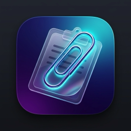

# MacClipboard 📋

> 一个轻量、高效且美观的 macOS 菜单栏剪贴板管理工具。基于 **SwiftUI + SwiftData + AppKit** 打造。



[](LICENSE)
[](https://apple.com/macos)
[](https://swift.org)

---

## ✨ 核心特性 (Features)

- 🚀 **全局唤出与快捷键盘导航**：按 `⌥⇧V` (Option + Shift + V) 随时唤出，支持键盘 `↑/↓` 翻页选择与 `Enter` 快捷粘贴。
- ⚡️ **智能去重与自动淘汰**：连续复制相同文本/图片自动更新置顶时间，自定义存储容量上限（100 ~ 2000 条）。
- 🎨 **多类型识别与展示**：自动分类展示文本、纯文本、富文本 (RTF)、图片、网页链接、Finder 文件引用及 HEX 颜色值色块。
- 🔒 **隐私与黑名单屏蔽**：
  - 自动拦截 1Password、Bitwarden、KeePassXC、Keychain Access 等密码管理器。
  - 正则表达式敏感字段过滤（如信用卡号、身份证号自动忽略）。
  - 支持快捷开启「无痕模式」(Incognito Mode)，状态栏图标实时联动显示 `eye.slash`。
- 🛠 **灵活粘贴模式**：支持一键切换「自动模拟 Cmd+V 粘贴」与「纯文本粘贴 (Paste as Plain Text)」，也可 `Shift + 点击` 单次强制纯文本。
- 🔐 **本地加密存储**：历史内容（含图片 / RTF）以 AES-GCM 加密落盘，密钥保存在系统 Keychain。
- 🌍 **中英双语**：基于 String Catalog 的界面国际化（zh-Hans / en）。
- 📌 **片段库 (Snippets)**：将高频内容保存为命名片段（文本 / 图片），独立于历史、永不淘汰；支持右键或 `⌘S` 从历史一键保存、重命名与搜索。
- 🗂 **片段分组 (Boards)**：片段可归入自定义分组，分组 chip 支持过滤、重命名、删除，可把片段直接**拖拽**到分组上归类。
- ⌨️ **可自定义全局热键**：在偏好设置中点击录制即可更换唤出快捷键（须含 ⌘/⇧/⌥/⌃ 修饰键），即时生效。
- 🎴 **横向卡片流布局**：历史面板可在「文本列表」与「横向卡片流」两种布局间切换（卡片流类似 Paste 的预览条）。
- ⚡ **上下文快速操作**：链接卡片直接「打开链接」、文件卡片「在 Finder 中显示」、文本卡片「用 Google 搜索」、颜色卡片「复制 RGB / HSL」。
- 🖱 **原生右键状态栏菜单**：右键菜单栏图标快速调出设置、切换无痕模式或退出应用。

---

## ⌨️ 快捷键指南 (Shortcuts)

| 快捷键 | 功能 |
| :--- | :--- |
| `⌥⇧V` | 全局唤出 / 隐藏剪贴板面板（可在偏好设置自定义） |
| `↑` / `↓` | 列表中上下选择卡片 |
| `Enter` | 粘贴当前选中卡片 |
| `空格` | 预览当前选中卡片（长文本 / 大图 / 文件路径） |
| `⌘C` | 将当前选中卡片复制到剪贴板 |
| `⌘P` | 置顶 / 取消置顶当前卡片 |
| `⌘⌫` | 删除当前选中卡片 |
| `⌘S` | 将当前选中卡片保存为片段 |
| `⌘,` | 打开偏好设置 |
| `Shift + 点击` | 本次强制以纯文本粘贴 |

---

## 📦 下载与安装 (Installation)

### 方式 1：直接下载 DMG (推荐)

在 [Releases](https://github.com/hilongzzz/MacClipboard/releases) 页面下载最新的 `MacClipboard.dmg`：

1. 双击打开 `MacClipboard.dmg`。
2. 将 **MacClipboard.app** 拖入 **Applications** 文件夹。
3. 启动应用，并在「系统设置 -> 隐私与安全性 -> 辅助功能」中开启权限以使用自动 Cmd+V 粘贴功能。

### 方式 2：从源码编译构建

```bash
# 1. 克隆代码库
git clone https://github.com/hilongzzz/MacClipboard.git
cd MacClipboard

# 2. 使用 xcodebuild 编译 Release App
xcodebuild -project MacClipboard.xcodeproj -scheme MacClipboard -configuration Release -derivedDataPath ./build/DerivedData build

# 3. 打包生成 DMG
mkdir -p build/DMG_Staging
cp -R build/DerivedData/Build/Products/Release/MacClipboard.app build/DMG_Staging/
ln -s /Applications build/DMG_Staging/Applications
hdiutil create -volname "MacClipboard" -srcfolder build/DMG_Staging -ov -format UDZO MacClipboard.dmg
```

---

## 🏗 技术栈 (Tech Stack)

- **语言**: Swift 5 / Xcode 15+
- **UI 框架**: SwiftUI + AppKit
- **数据持久化**: SwiftData (`@Model`, `@Query`, `@Attribute(.externalStorage)`)
- **系统集成**: `NSPasteboard`, `CGEvent`, `SMAppService` (开机自启), `ApplicationServices` (AXIsProcessTrustedWithOptions)

---

## 📄 开源协议 (License)

本项目基于 [MIT License](LICENSE) 协议开源。欢迎 Issue 与 PR！
